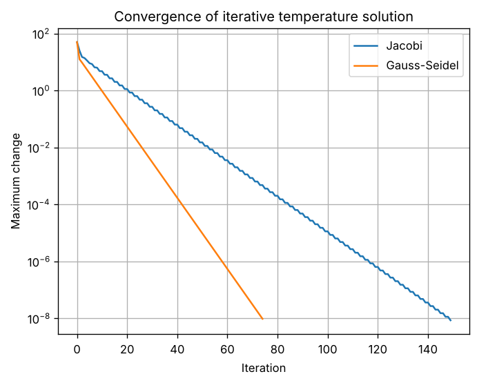

# Task 8: Iterative Methods for Linear Systems

**Application:** Heat transfer, large sparse systems

## 1. Original program (`code/Task_08_iterative_linear.py`)

### Inputs and mathematical operation

**Inputs:** a 5×5 tridiagonal matrix (temperature grid), right-hand side b = [100,0,0,0,20] (boundary heat), tolerance 1e-8.

**Operation:** start from zeros and update each unknown from the others (Jacobi uses old values, Gauss-Seidel uses the newest values) until the largest change is below the tolerance.

### Output

```
Jacobi temperatures: [86.66666665 73.33333331 59.99999997 46.66666664 33.33333332]
Gauss-Seidel temperatures: [86.66666665 73.3333333  59.99999997 46.66666665 33.33333332]
Direct solution: [86.66666667 73.33333333 60.         46.66666667 33.33333333]
Jacobi iterations: 150
Gauss-Seidel iterations: 75
```

### Meaning of the output

Both methods give about 86.67, 73.33, 60, 46.67, 33.33 °C, matching the direct solution: temperature drops steadily from the hot side to the cold side. On the graph (log scale) both lines fall straight down, which means the error shrinks by a constant factor each step. The Gauss-Seidel line is steeper, so it converges faster.



## 2. Changing a parameter (`code/Task_08_iterative_linear_extended.py`, Part A)

I changed the boundaries to 200 °C and 50 °C and compared tolerances 1e-4 and 1e-10. Jacobi needed 90 then 188 iterations; Gauss-Seidel needed 46 then 94. A stricter tolerance needs more iterations, and Gauss-Seidel always needs about half as many as Jacobi. The temperatures became 175, 150, 125, 100, 75 (a straight line).

## 3. New real-world case: Metal rod with 20 points (Part B of the same file)

### Assumptions and input data

Rod ends held at 150 °C and 30 °C, 20 interior points, no heat source. The steady state is a straight line.

### Output

```
PART A: boundaries 200/50, tolerances 1e-4 and 1e-10
tol=0.0001: Jacobi 90 iterations, Gauss-Seidel 46 iterations
tol=1e-10: Jacobi 188 iterations, Gauss-Seidel 94 iterations
Temperatures (Gauss-Seidel, tol 1e-10): [175. 150. 125. 100.  75.]

PART B: rod with 20 points
Jacobi iterations: 1709, Gauss-Seidel iterations: 860
Max difference from direct solution (Gauss-Seidel): 4.389112149283392e-07
Temperature at points 1, 10, 20: [144.29  92.86  35.71]
```

### Interpretation

Jacobi took 1709 iterations and Gauss-Seidel 860. Both match the direct solution (largest difference about 4e-7). More points means slower iteration, which shows why better methods are used for huge grids. The temperature falls from 144.29 °C at point 1 to 35.71 °C at point 20.
