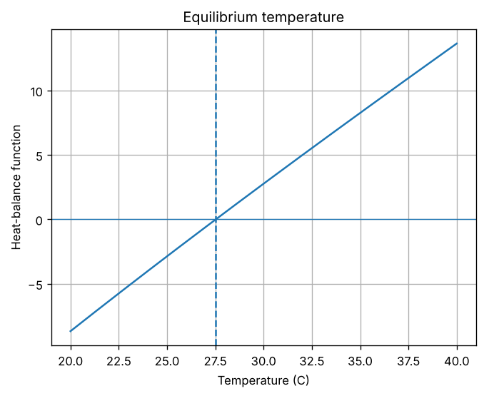

# Task 10: Root Finding: Bisection and Fixed-Point Methods

**Application:** Break-even points, equilibrium

## 1. Original program (`code/Task_10_bisection_fixed_point.py`)

### Inputs and mathematical operation

**Inputs:** the function f(T) = T − 25 − 10e^(−T/20), bracket [20, 40], tolerance 1e-10, starting guess 30 for fixed point.

**Operations:** bisection halves the interval that holds the sign change; fixed-point repeats T = 25 + 10e^(−T/20).

### Output

```
Bisection equilibrium temperature: 27.525211 C
Bisection iterations: 38
Fixed-point equilibrium temperature: 27.525211 C
Fixed-point iterations: 13
```

### Meaning of the output

The equilibrium temperature is 27.525 °C, where heat gain equals heat loss. Both methods agree. On the graph the curve crosses zero at that temperature (dashed line). Below it f is negative (the system is gaining heat), above it f is positive. Bisection needed 38 steps while fixed point needed only 13 here.



## 2. Changing a parameter (`code/Task_10_bisection_fixed_point_extended.py`, Part A)

I changed the coefficient 10 to 20 (more heat). The equilibrium moved from 27.5252 °C to 29.5615 °C. Bisection took the same number of steps (about 39) but fixed-point needed 16 instead of 12 steps, so it converges more slowly when the curve is steeper.

## 3. New real-world case: Bakery break-even (Part B of the same file)

### Assumptions and input data

Revenue R(q) = 120·q·e^(−q/150) (price drops as more loaves are sold), cost C(q) = 2000 + 30q (KES). Break-even is R(q) = C(q).

### Output

```
PART A: effect of coefficient c
c=10: bisection=27.525211 C (39 its), fixed-point=27.525211 C (12 its)
c=20: bisection=29.561521 C (39 its), fixed-point=29.561521 C (16 its)

PART B: bakery break-even
Break-even at q = 29.04 loaves, revenue = KES 2871.06
Break-even at q = 153.98 loaves, revenue = KES 6619.53
Maximum daily profit near q = 84 loaves: KES 1237.81
```

### Interpretation

There are two break-even points: about 29 loaves and about 154 loaves a day. The bakery makes a profit only between them, and the best is at about 84 loaves (profit about KES 1,238). Selling too many loaves lowers the price so much that profit disappears again.
