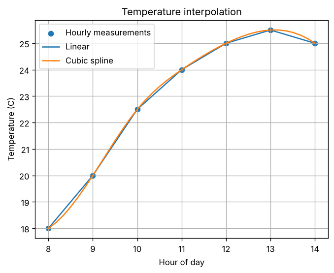

# Task 13: Interpolation

**Application:** Sensor calibration, missing data

## 1. Original program (`code/Task_13_interpolation.py`)

### Inputs and mathematical operation

**Inputs:** hourly temperatures from 08:00 to 14:00.

**Operations:** `interp1d` joins points with straight lines; `CubicSpline` fits smooth curves. Both estimate the 10-minute values.

### Output

```
Linear estimate at 10:30: 23.25 C
Cubic estimate at 10:30: 23.36 C
```

### Meaning of the output

At 10:30 the linear estimate is 23.25 °C and the cubic is 23.36 °C, slightly higher because the temperature curve is bending. On the graph the dots are real measurements; the linear line has corners, the cubic line is smooth. Both pass through every measured point.



## 2. Changing a parameter (`code/Task_13_interpolation_extended.py`, Part A)

I changed the 12:00 reading from 25.0 to 30.0 °C. At 11:30 the linear estimate rose from 24.50 to 27.00 and the cubic from 24.54 to 27.44. The cubic reacts more because it makes a smooth curve through the point and its neighbours.

## 3. New real-world case: Missing soil-moisture reading (Part B of the same file)

### Assumptions and input data

Soil moisture (%) is recorded daily; the day-4 sensor failed. Known days: 1,2,3,5,6,7.

### Output

```
PART A original: at 11:30 linear=24.50 C, cubic=24.54 C
PART A changed : at 11:30 linear=27.00 C, cubic=27.44 C

PART B: missing soil moisture on day 4
Linear estimate: 28.90 %
Cubic spline   : 28.95 %
```

### Interpretation

The estimate for day 4 is 28.90% (linear) or 28.95% (cubic). They are very close because the data falls steadily, so the missing value is reliably about 29%.
