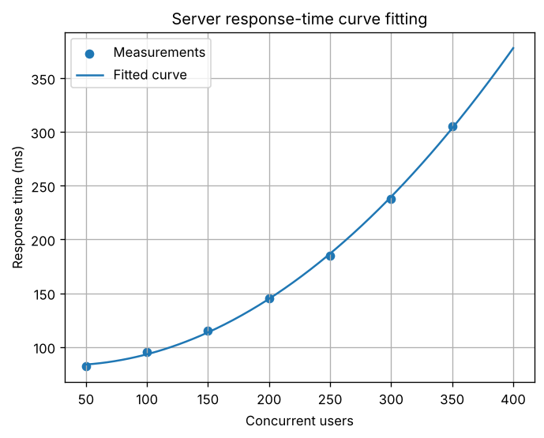

# Task 14: Curve Fitting and Approximation

**Application:** Trend estimation, forecasting

## 1. Original program (`code/Task_14_curve_fitting.py`)

### Inputs and mathematical operation

**Inputs:** users (50–350) and response times (82–305 ms).

**Operation:** `curve_fit` finds a, b, c in y = ax² + bx + c that minimize the sum of squared residuals. RMSE measures the average error.

### Output

```
Fitted model: y = 0.002167x^2 + -0.1345x + 85.00
RMSE: 1.55 ms
Predicted response at 400 users: 377.86 ms
```

### Meaning of the output

The fitted curve is y = 0.002167x² − 0.1345x + 85. An RMSE of 1.55 ms means predictions are about 1.5 ms off on average. On the graph the curve passes close to all points and bends upward: response time grows faster as load rises. The 400-user prediction of 377.9 ms is extrapolation and should be used with care.



## 2. Changing a parameter (`code/Task_14_curve_fitting_extended.py`, Part A)

I changed the model from quadratic to a straight line. The RMSE rose from 1.55 ms to 18.83 ms and the 400-user prediction changed from 377.9 ms to 312.9 ms. The line cannot follow the upward bend, so the quadratic is the better model.

## 3. New real-world case: Growth of a campus app's users (Part B of the same file)

### Assumptions and input data

Monthly active users (thousands) for 8 months: 2.1 to 11.3. Assumed model y = a·e^(bx).

### Output

```
PART A linear   : RMSE=18.83 ms, prediction at 400 users=312.9 ms
PART A quadratic: RMSE=1.55 ms, prediction at 400 users=377.9 ms

PART B: user growth
Fitted: y = 1.627 * exp(0.2420 x)
RMSE = 0.040 thousand users; monthly growth = 27.4%
Forecast month 10: 18.3 thousand users
```

### Interpretation

The fit is y = 1.627·e^(0.242x) with RMSE 0.04 thousand users, so the model suits the data. That is about 27.4% growth per month and a forecast of 18.3 thousand users in month 10. Exponential growth cannot continue forever, so the forecast is only short-term.
