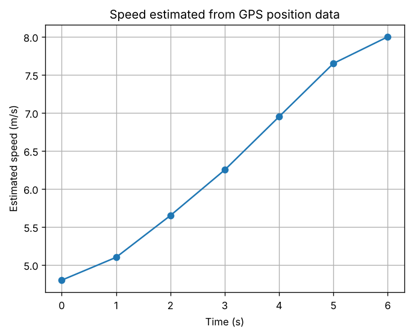

# Task 15: Numerical Differentiation

**Application:** Speed from position data

## 1. Original program (`code/Task_15_numerical_differentiation.py`)

### Inputs and mathematical operation

**Inputs:** GPS times 0–6 s and positions 0–38 m.

**Operations:** forward difference at the first point, central difference (next − previous) / (2 × step) inside, backward difference at the end.

### Output

```
t=0s, position=0.0m, estimated speed=4.80m/s
t=1s, position=4.8m, estimated speed=5.10m/s
t=2s, position=10.2m, estimated speed=5.65m/s
t=3s, position=16.1m, estimated speed=6.25m/s
t=4s, position=22.7m, estimated speed=6.95m/s
t=5s, position=30.0m, estimated speed=7.65m/s
t=6s, position=38.0m, estimated speed=8.00m/s
```

### Meaning of the output

Estimated speed rises from 4.8 m/s to 8.0 m/s: the vehicle is speeding up. The graph rises steadily, so acceleration is roughly constant at about 0.8 m/s². The end values are less accurate because they use one-sided differences.



## 2. Changing a parameter (`code/Task_15_numerical_differentiation_extended.py`, Part A)

I tested the step size h = 0.1, 0.01, 0.001 on sin(x) at x = 1. Forward-difference error fell 10 times per step (4.3e-2 to 4.2e-4) while central-difference error fell 100 times (9e-4 to 9e-8). Central difference is far more accurate for the same h.

## 3. New real-world case: Acceleration of a matatu (Part B of the same file)

### Assumptions and input data

Speed (m/s) is logged every 2 s for 12 s. Acceleration is the rate of change of speed, found with `np.gradient`.

### Output

```
PART A: derivative of sin(x) at x=1 (exact = cos(1) = 0.54030231)
h=0.1   : forward error=4.29e-02, central error=9.00e-04
h=0.01  : forward error=4.22e-03, central error=9.00e-06
h=0.001 : forward error=4.21e-04, central error=9.01e-08

PART B: acceleration from speed data
t=   0s speed=  0.0 m/s acceleration= 1.55 m/s^2
t=   2s speed=  3.1 m/s acceleration= 1.60 m/s^2
t=   4s speed=  6.4 m/s acceleration= 1.52 m/s^2
t=   6s speed=  9.2 m/s acceleration= 1.15 m/s^2
t=   8s speed= 11.0 m/s acceleration= 0.73 m/s^2
t=  10s speed= 12.1 m/s acceleration= 0.38 m/s^2
t=  12s speed= 12.5 m/s acceleration= 0.20 m/s^2
Largest acceleration at t=2s: 1.60 m/s^2
```

### Interpretation

Acceleration is highest at the start (about 1.6 m/s²) and then falls to 0.2 m/s² as the vehicle approaches its top speed of about 12.5 m/s.
