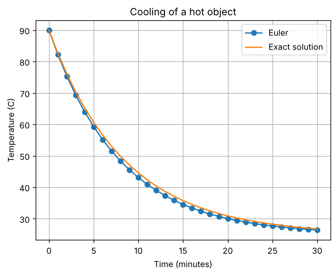

# Task 17: Ordinary Differential Equations – Euler Method

**Application:** Cooling, population growth

## 1. Original program (`code/Task_17_euler_ode.py`)

### Inputs and mathematical operation

**Inputs:** ambient 25 °C, initial 90 °C, k = 0.12, step h = 1 minute, 30 minutes.

**Operation:** Euler update T(next) = T + h·(−k(T − 25)) repeated 30 times, compared with the exact solution.

### Output

```
Euler temperature after 30 min: 26.40 C
Exact temperature after 30 min: 26.78 C
Final absolute error: 0.3720 C
```

### Meaning of the output

After 30 minutes Euler gives 26.40 °C against the exact 26.78 °C (error 0.37 °C). On the graph the temperature drops quickly at first and then slowly levels toward 25 °C, and the Euler dots sit slightly below the exact curve.



## 2. Changing a parameter (`code/Task_17_euler_ode_extended.py`, Part A)

I changed h to 5, 1 and 0.1 minutes. The final error was 1.51 °C, 0.37 °C and 0.038 °C. A smaller step is more accurate but takes more steps.

## 3. New real-world case: Fish pond population (logistic growth) (Part B of the same file)

### Assumptions and input data

dP/dt = rP(1 − P/K) with r = 0.4 per month, K = 1000 fish, P(0) = 50, step 0.5 month.

### Output

```
PART A: Euler error at 30 min for different h (exact = 26.7760 C)
h=5.0 : Euler=25.2662 C, error=1.5098 C
h=1.0 : Euler=26.4041 C, error=0.3720 C
h=0.1 : Euler=26.7378 C, error=0.0383 C

PART B: logistic growth in a fish pond
Month  6: Euler=  332.5, exact=  367.2
Month 12: Euler=  853.0, exact=  864.8
Month 18: Euler=  987.9, exact=  986.0
Month 24: Euler=  999.2, exact=  998.7
Month when Euler passes 500 fish: 8.0
```

### Interpretation

The population grows slowly, quickly in the middle and then levels at about 1000 fish. Euler reaches 500 fish at month 8. It is a bit below the exact curve at month 6 (332 vs 367) but matches at the end (999 vs 999). The pond reaches its limit in roughly two years.
