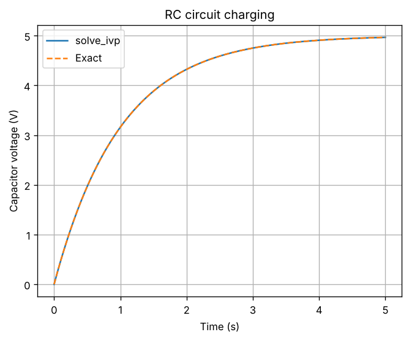

# Task 18: Numerical Solution of ODEs Using SciPy

**Application:** Circuits, epidemiology

## 1. Original program (`code/Task_18_scipy_ode.py`)

### Inputs and mathematical operation

**Inputs:** Vs = 5 V, R = 1000 Ω, C = 0.001 F, V0 = 0, time 0–5 s.

**Operation:** `solve_ivp` solves dV/dt = (Vs − V)/(RC) with automatic step size and tight tolerances.

### Output

```
Solver success: True
Capacitor voltage at 5 s: 4.9663 V
Maximum error against exact solution: 9.282e-10 V
```

### Meaning of the output

The capacitor charges from 0 V to 4.9663 V in 5 s. The error against the exact formula is about 1e-9 V. The graph rises quickly and flattens at 5 V, and the solver and exact curves lie on each other.



## 2. Changing a parameter (`code/Task_18_scipy_ode_extended.py`, Part A)

I doubled the resistance to 2000 Ω. The time constant RC went from 1 s to 2 s, so charging is slower: at 10 s the voltage is 4.966 V instead of 5.000 V. In both cases the voltage at one time constant is 3.161 V, about 63.2% of 5 V.

## 3. New real-world case: SIR epidemic in a school (Part B of the same file)

### Assumptions and input data

1000 students, 1 infected. Infection rate β = 0.35/day, recovery rate γ = 0.10/day, 120 days. Equations for S, I and R.

### Output

```
PART A: R=1000 ohm, time constant=1 s, V at tau=3.161 V (63.2% of 5 V = 3.161), V at 10 s=5.000 V
PART A: R=2000 ohm, time constant=2 s, V at tau=3.161 V (63.2% of 5 V = 3.161), V at 10 s=4.966 V

PART B: SIR epidemic in a school
R0 = beta/gamma = 3.5
Peak infections: 357 students on day 32
Total ever infected by day 120: 966
Check S+I+R at the end = 1000.0
```

### Interpretation

R0 = β/γ = 3.5, so the infection spreads. Infections peak at about 357 students on day 32, and about 966 students are infected in total. S + I + R stays 1000, which is a good check.
